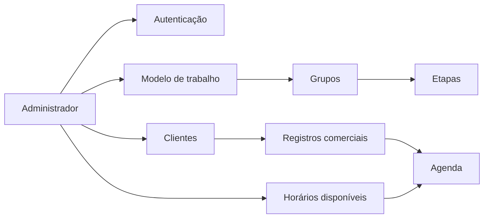
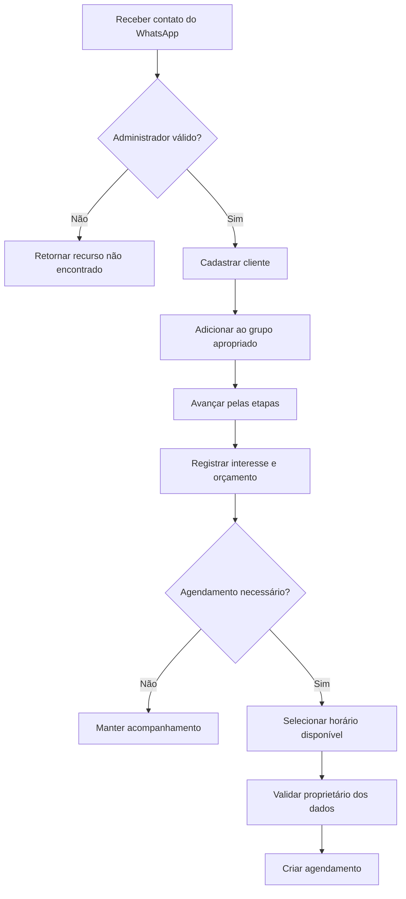

# CRM API — Domain

> API de domínio para organização comercial e gestão de clientes obtidos pelo WhatsApp.

O projeto concentra as regras de negócio de um CRM em **Clean Architecture**: administradores possuem modelos de trabalho, modelos recebem grupos e cada grupo possui etapas. Os contatos são registrados como clientes e podem gerar registros comerciais, horários disponíveis e agendamentos.

---

## Progresso do projeto

### [██████████████░░░░░░░░░░░░░░░] 45%

| Etapa | Situação |
|---|---|
| Entidades de domínio | Em andamento |
| Casos de uso | Em desenvolvimento |
| Repositórios em memória | Disponíveis para testes |
| Testes unitários | Parcialmente implementados |
| Camada HTTP/API | Ainda não implementada neste domínio |
| Banco de dados externo | Ainda não conectado |

---

## Visão geral



### Conceito principal

1. Um **administrador** cria sua conta e autentica-se.
2. O administrador configura um **modelo** para uma empresa ou operação.
3. O modelo é dividido em **grupos** de clientes.
4. Cada grupo recebe **etapas** que representam o andamento do processo comercial.
5. Contatos vindos do WhatsApp são cadastrados como **clientes**.
6. Cada cliente pode possuir um **registro** com origem, interesse, orçamento, tags e próximas ações.
7. **Horários** são associados ao administrador e podem ser usados em **agendamentos**.

---

## Funcionalidades

### Administrador

| Funcionalidade | Caso de uso | Fluxo da aplicação | Resultado |
|---|---|---|---|
| Criar conta | `CreateAdminUseCase` | Recebe dados → verifica e-mail duplicado → gera hash da senha → cria o administrador | Conta criada ou `EmailAlreadyExistError` |
| Autenticar | `GetAdminUseCase` | Busca por e-mail → compara a senha → gera token criptografado | `access_token` ou erro de credenciais/recurso |
| Buscar administrador | `GetAdminUseCase` | Consulta o repositório pelo identificador | Retorna o administrador ou recurso não encontrado |
| Editar administrador | `EditAdminUseCase` | Valida o administrador → verifica permissão → atualiza dados do perfil | Perfil atualizado |
| Excluir administrador | `DeleteAdminUseCase` | Localiza o administrador → remove o recurso | Conta excluída ou recurso não encontrado |

### Modelos de trabalho

| Funcionalidade | Caso de uso | Fluxo da aplicação | Resultado |
|---|---|---|---|
| Criar modelo | `CreateModelUseCase` | Valida o administrador → cria um modelo vinculado à empresa | Modelo criado |
| Buscar modelo | `GetModelUseCase` | Valida o identificador do administrador e do modelo | Retorna o modelo |
| Listar modelos | `GetModelsUseCase` | Consulta todos os modelos do administrador | Lista de modelos |
| Pesquisar modelos | `SearchModelsUseCase` | Recebe parâmetros de busca e consulta o repositório | Lista filtrada |
| Editar modelo | `EditModelUseCase` | Localiza o modelo → verifica propriedade → atualiza os dados | Modelo atualizado |
| Excluir modelo | `DeleteModelUseCase` | Valida propriedade → remove o modelo | Modelo excluído |
| Duplicar modelo | `AggregateModelUseCase` | Localiza o modelo original → copia grupos e etapas → cria o novo modelo | Nova configuração baseada no modelo existente |

### Grupos

| Funcionalidade | Caso de uso | Fluxo da aplicação | Resultado |
|---|---|---|---|
| Criar grupo | `CreateGroupUseCase` | Valida administrador e modelo → verifica vínculo → cria o grupo pelo tipo | Grupo criado |
| Listar grupos | `GetGroupUseCase` | Consulta grupos associados ao administrador/modelo | Lista de grupos |
| Editar grupo | `EditGroupUseCase` | Localiza o grupo → valida propriedade → altera o tipo | Grupo atualizado |
| Excluir grupo | `DeleteGroupUseCase` | Valida propriedade → remove o grupo | Grupo excluído |

### Etapas

| Funcionalidade | Caso de uso | Fluxo da aplicação | Resultado |
|---|---|---|---|
| Criar etapa | `CreateStageUseCase` | Valida administrador, grupo e modelo → verifica propriedade → cria a etapa | Etapa criada no grupo |
| Consultar etapas | `GetStageUseCase` | Localiza o grupo vinculado ao administrador/modelo | Lista de etapas |
| Editar etapa | `EditStageUseCase` | Valida propriedade → altera o nome da etapa | Etapa atualizada |
| Excluir etapa | `DeleteStageUseCase` | Valida propriedade → remove a etapa | Etapa excluída |

### Clientes do WhatsApp

| Funcionalidade | Caso de uso | Fluxo da aplicação | Resultado |
|---|---|---|---|
| Cadastrar cliente | `CreateClientUseCase` | Valida o administrador → registra nome e telefone → salva a data de criação | Cliente salvo |
| Buscar clientes por administrador | `GetClientUseCase` | Consulta o repositório pelo identificador do administrador | Lista de clientes |
| Pesquisar clientes | `GetClientUseCase` por parâmetros | Filtra por nome e/ou telefone dentro do administrador autenticado | Lista filtrada |
| Editar cliente | `EditClientUseCase` | Localiza o cliente → verifica propriedade → atualiza nome ou telefone | Cliente atualizado |
| Excluir cliente | `DeleteClientUseCase` | Verifica autorização → remove o cliente | Cliente excluído |

### Horários

| Funcionalidade | Caso de uso | Fluxo da aplicação | Resultado |
|---|---|---|---|
| Criar horário | `CreateTimeUseCase` | Valida o administrador → adiciona a disponibilidade | Horário criado |
| Consultar horário | `GetTimeUseCase` | Busca um horário vinculado ao administrador | Horário encontrado ou recurso não encontrado |
| Excluir horário | `DeleteTimeUseCase` | Valida propriedade → remove a disponibilidade | Horário excluído |

### Registros comerciais

| Funcionalidade | Caso de uso | Situação atual |
|---|---|---|
| Criar registro | `CreateRecordUseCase` | Estrutura preparada; implementação pendente |
| Consultar registro | `GetRecordUseCase` | Estrutura preparada; implementação pendente |
| Editar registro | `EditRecordUseCase` | Estrutura preparada; implementação pendente |
| Excluir registro | `DeleteRecordUseCase` | Estrutura preparada; implementação pendente |

Um registro possui: cliente, tipo, etapa, interesse, origem, propriedade de interesse, orçamento, próximo contato, período, tags, observações e data de criação.

### Agendamentos

| Funcionalidade | Caso de uso | Fluxo da aplicação | Resultado |
|---|---|---|---|
| Criar agendamento | `CreateScheduleUseCase` | Valida administrador, cliente, registro e horário → verifica se pertencem ao mesmo administrador | Confirma compatibilidade dos dados |

---

## Fluxo completo da aplicação



---

## Estrutura do domínio

| Entidade | Principais responsabilidades |
|---|---|
| `Admin` | Identidade, e-mail, senha, imagem e data de criação |
| `Client` | Nome, telefone e vínculo com o administrador |
| `Model` | Empresa, proprietário e data de criação |
| `Group` | Tipo e vínculo com um modelo |
| `Stage` | Nome e vínculo com um grupo |
| `Record` | Dados comerciais e acompanhamento do cliente |
| `Time` | Horários disponíveis do administrador |
| `Schedule` | Relação entre administrador, cliente, registro e horário |

---

## Tratamento de erros

O domínio utiliza `Either` para separar resultados de sucesso e falha sem exceções para regras de negócio.

| Erro | Quando ocorre |
|---|---|
| `ResourceNotFoundError` | Entidade ou identificador não encontrado |
| `EmailAlreadyExistError` | E-mail já utilizado em uma conta |
| `WrongCredentialsError` | Senha não corresponde ao usuário |
| `NotAllowedError` | Recursos não pertencem ao administrador autenticado |

---

## Arquitetura

```text
src/
├── core/
│   ├── either.ts
│   ├── entity.ts
│   ├── unique-entityId.ts
│   └── errors/
├── domain/
│   ├── aplication/
│   │   ├── cryptography/
│   │   ├── repository/
│   │   └── use-case/
│   └── enterprise/
└── test/
    ├── cryptography/
    ├── factory/
    └── in-memory-repository/
```

Os casos de uso dependem de interfaces de repositório e criptografia. Os repositórios em memória permitem testar a lógica sem infraestrutura externa.

---

## Como executar

### Pré-requisitos

- Node.js
- npm

### Instalação

```bash
npm install
```

### Executar testes

```bash
npm test
```

### Executar testes em modo watch

```bash
npm run test:watch
```

---

## Próximos passos

- [ ] Finalizar os casos de uso de registros comerciais
- [ ] Concluir o caso de criação de agendamento
- [ ] Adicionar adaptadores HTTP
- [ ] Conectar um banco de dados real
- [ ] Integrar a coleta de contatos do WhatsApp
- [ ] Publicar a documentação dos endpoints
- [ ] Ampliar a cobertura de testes